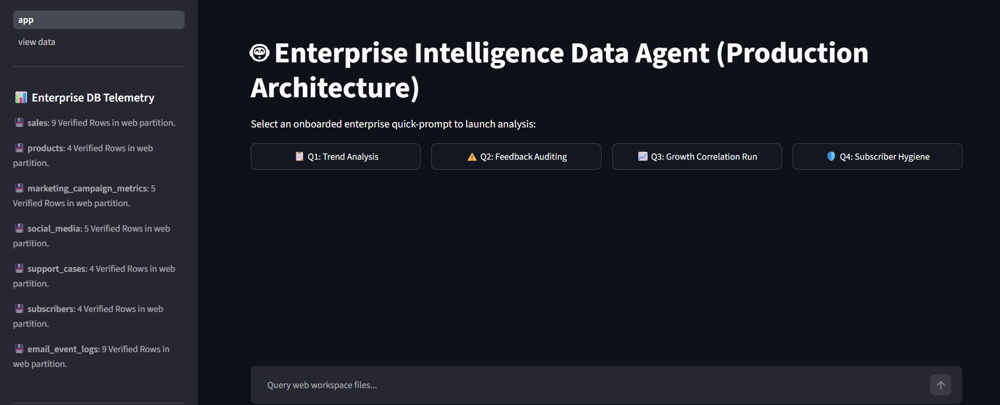
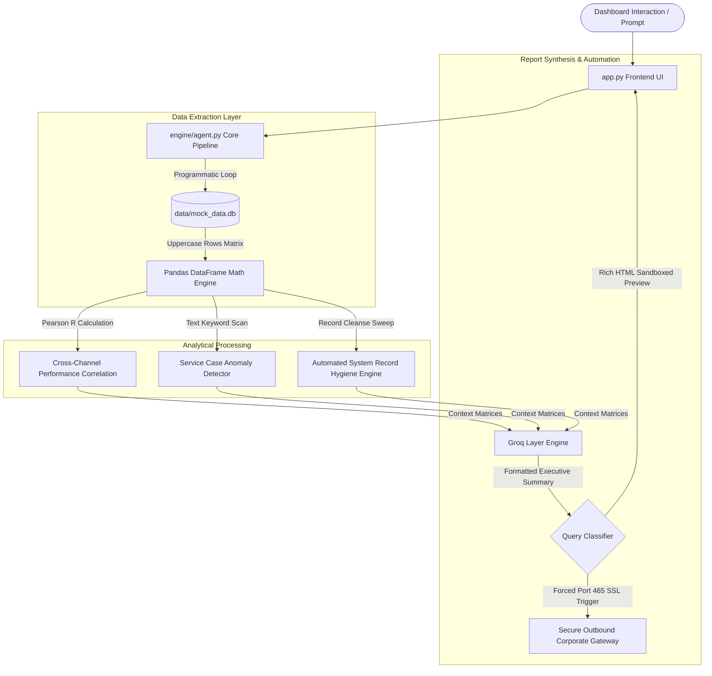
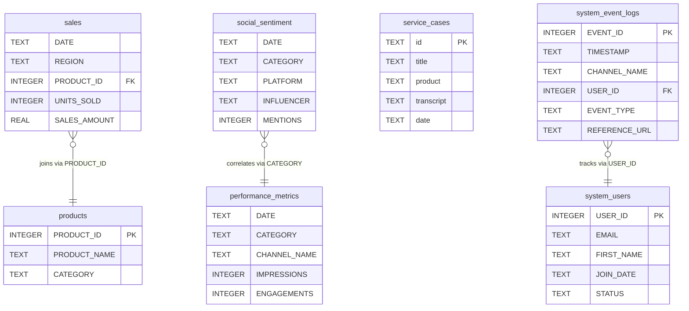

# 🤖 Enterprise Intelligence Data Agent (Production Architecture)

A decentralized, local analytics microservice architecture designed to parse enterprise sales, cross-channel performance metrics, social sentiment, and customer service data. It merges local algorithmic execution using Pandas matrix math and text keyword scanning with automated record hygiene loops and structured LLM synthesis to generate highly visual, responsive HTML executive reports.

All components are dynamically aligned with the project's data schema requirements, enforcing strict uppercase data dimensions and utilizing local SQLite processing layers.

---


---

## 📊 System Architecture & Process Flow

The system separates raw database querying and heavy mathematical calculations from text synthesis, ensuring zero SQL-injection vulnerabilities, sandboxed HTML frontend rendering, and stable runtime execution.

### 1. Data Ingestion & System Interaction Funnel


### 2. Database Schema Mappings
Enforced across the application to ensure flawless joins, cross-channel calculation lookups, and system telemetry delivery tracking:



---

## 🚀 Quick Start & Installation

Follow these sequential steps to configure your environment variables and boot the application container locally.

### 1. Clone & Install Dependencies
Ensure you have Python 3.10+ installed on your local machine.
```bash
git clone https://github.com
cd enterprise-intelligence-data-agent
pip install -r requirements.txt
```

### 2. Configure Streamlit Secrets Configuration Mappings
Create a local secrets project initialization profile configuration file named **`.streamlit/secrets.toml`** directly inside the project root folder:
```bash
mkdir .streamlit
touch .streamlit/secrets.toml
```
Open the `secrets.toml` file and populate it with your active processing parameters:
```toml
# 🔑 Groq Processing Layer Engine Keys
GROQ_API_KEY = "gsk_your_actual_groq_api_token_here"

# ✉️ Secure Outbound Mail Gateway Routing Parameters
SMTP_SERVER = "smtp.gmail.com"
SMTP_PORT = 465
SMTP_USER = "your_authenticated_corporate_email@gmail.com"
SMTP_PASSWORD = "your_16_character_google_app_password"

# 📬 Target Report Inbox Destination Mappings
REPORT_RECIPIENT = "your_personal_receiving_mailbox@domain.com"
```

### 3. Initialize & Seed Database Footprint
Run the setup pipeline to compile directories, construct the upgraded uppercase database layout schemas, and seed live row metrics across the 4 fiscal quarters:
```bash
python setup.py
```

### 4. Boot the Microservice Dashboard Application
Launch your Streamlit web server dashboard instance locally:
```bash
streamlit run app.py
```

---

## ⚙️ Core Application Interface Workflows

The application dashboard provides four pre-onboarded automated quick-prompt tasks:

*   **📋 Q1: Trend Analysis (Sales Audit):** Compiles the full annual transactional history matrix across all product categories. Automatically sends out a summary report titled `📊 Q1 Executive Operations Audit - 2025 Sales Trends`.
*   **⚠️ Q2: Feedback Auditing (Jacket Quality Risk):** Scans customer service logs for structural defects. Programmatically isolates critical anomalies (such as the *Thermal Expedition Parka* armpit seam tearing failures) and sends out an alert titled `⚠️ Q2 Executive Operations Audit - Product Quality Log`.
*   **📈 Q3: Growth Correlation Run (Performance RPC):** Performs a Pearson Product-Moment Correlation calculation ($R = 0.9652$) between internal system click logs and active social media impressions. Delivers a report titled `📈 Q3 Executive Operations Audit - Channel Correlation Run`.
*   **🛡️ Q4: Record Hygiene (System Integrity Matrix):** Evaluates interaction boundaries and bounce thresholds. It computes live delivery telemetry logs, **automatically switches broken or deactivated user row records to inactive status metrics**, and dispatches a rich-text HTML advisory report titled `📋 Q4 Executive Operations Audit - System User Base Health`.

---

## 🛠️ Offline Testing & Debugging (Mock SMTP)

If you are running the system without an active internet gateway or DNS connection to live external mail relays, you can bypass network timeouts (`[Errno -2] Name or service not known`) by spinning up a local Python diagnostic mail interceptor loop:

1. Open a separate console terminal and start a dummy local debugging server:
   ```bash
   python -m smtpd -c DebuggingServer -n localhost:1025
   ```
2. Update your `.streamlit/secrets.toml` configuration keys to intercept metrics locally:
   ```toml
   SMTP_SERVER = "localhost"
   SMTP_PORT = 1025
   SMTP_USER = "test@local.me"
   SMTP_PASSWORD = "bypass_token"
   ```
Your analytical engine reports will now instantly print safely into your background terminal window without network delays.
