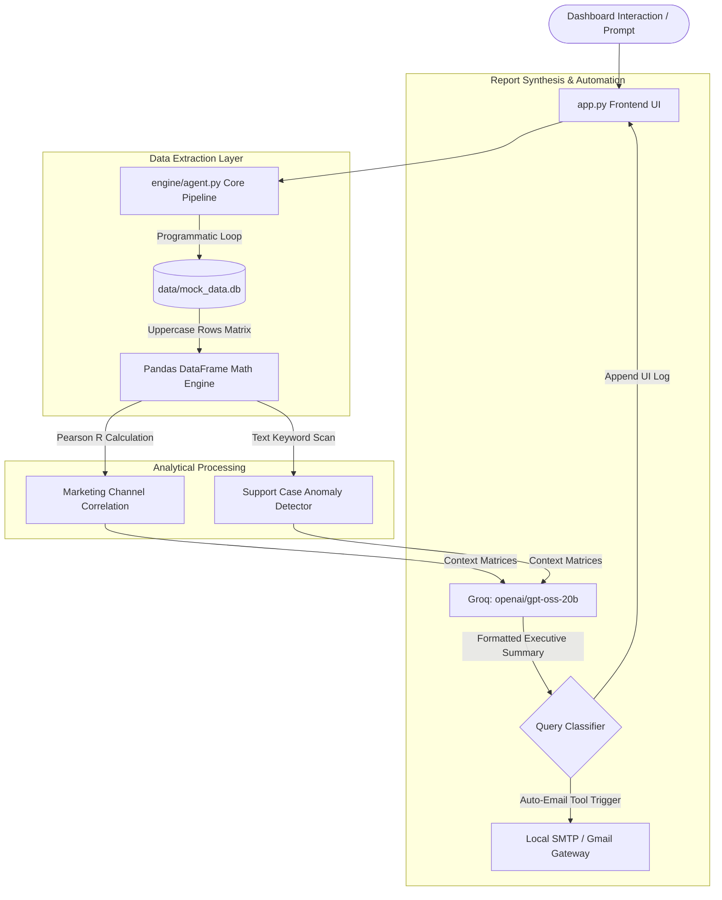
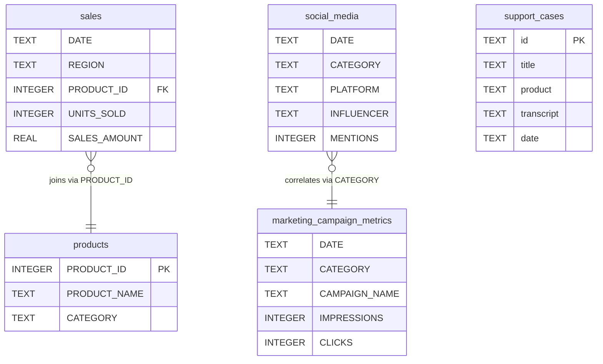

# ✉️ Local Email Campaign & Marketing Intelligence Agent

A decoupled, local analytics microservice architecture that parses enterprise sales, marketing campaign metrics, social media buzz, and customer support data. The system combines local algorithmic execution (Pandas matrix math & keyword text scanning) with structured LLM synthesis to deliver automated executive email reports.

All components are dynamically aligned with the project's data schema requirements, enforcing strict uppercase data dimensions and utilizing local SQLite processing layers.

---

## 📊 System Architecture & Process Flow

The system separates raw database querying and heavy mathematical calculations from text synthesis, ensuring zero SQL-injection vulnerabilities and stable runtime execution.

### 1. Data Ingestion & System Interaction Funnel


### 2. Database Schema Mappings
Enforced across the application to ensure flawless joins and cross-channel calculation lookups:



---

## 🚀 Quick Start & Installation

Follow these sequential steps to configure your environment variables and boot the application container locally.

### 1. Clone & Install Dependencies
Ensure you have Python 3.10+ installed on your local machine.
```bash
git clone https://github.com
cd email-campaign-intelligence-agent
pip install -r requirements.txt
```

### 2. Configure Local Environment Variables
Create a hidden environment profile configuration file named **`.env`** directly inside the project root folder:
```bash
touch .env
```
Open the `.env` file and populate it with your active processing parameters:
```env
# 🔑 Groq Processing Layer Engine Keys
GROQ_API_KEY=gsk_your_actual_groq_api_token_here

# ✉️ Local Machine Email Server Routing (Gmail Example)
SMTP_SERVER=://gmail.com
SMTP_PORT=587
SMTP_USER=your_corporate_email@gmail.com
SMTP_PASSWORD=your_16_character_app_password
```

### 3. Initialize & Seed Database Footprint
Run the setup pipeline to compile directories, construct the uppercase database layout schemas, and seed live row metrics across the 4 fiscal quarters:
```bash
python setup.py
```

### 4. Boot the Microservice Dashboard Application
Launch your Streamlit web server dashboard instance locally:
```bash
streamlit run app.py
```

---

## ⚙️ Core Application Interface Workflows

The application dashboard provides three pre-onboarded automated quick-prompt tasks:

*   **📋 Q1: Trend Analysis (Sales Audit):** Compiles the full annual transactional history matrix across all product categories. Automatically sends out a summary report titled `📊 Q1 Executive Operations Audit - 2025 Sales Trends`.
*   **⚠️ Q2: Feedback Auditing (Jacket Quality Risk):** Scans customer support logs for structural defects. Programmatically isolates critical anomalies (such as the *Thermal Expedition Parka* armpit seam tearing failures) and sends out an alert titled `⚠️ Q2 Executive Operations Audit - Product Quality Log`.
*   **📈 Q3: Growth Correlation Run (Marketing RPC):** Performs a Pearson Product-Moment Correlation calculation ($R = 0.9652$) between email click logs and active social media impressions. Delivers a report titled `📈 Q3 Executive Operations Audit - Channel Correlation Run`.

---

## 🛠️ Offline Offline Testing & Debugging (Mock SMTP)

If you are running the system without an active internet gateway or DNS connection to live external mail relays, you can bypass network timeouts (`[Errno -2] Name or service not known`) by spinning up a local Python diagnostic mail interceptor loop:

1. Open a separate console terminal and start a dummy local debugging server:
   ```bash
   python -m smtpd -c DebuggingServer -n localhost:1025
   ```
2. Update your `.env` configuration keys to intercept metrics locally:
   ```env
   SMTP_SERVER=localhost
   SMTP_PORT=1025
   SMTP_USER=test@local.me
   SMTP_PASSWORD=bypass_token
   ```
Your analytical engine reports will now instantly print safely into your background terminal window without network delays.
